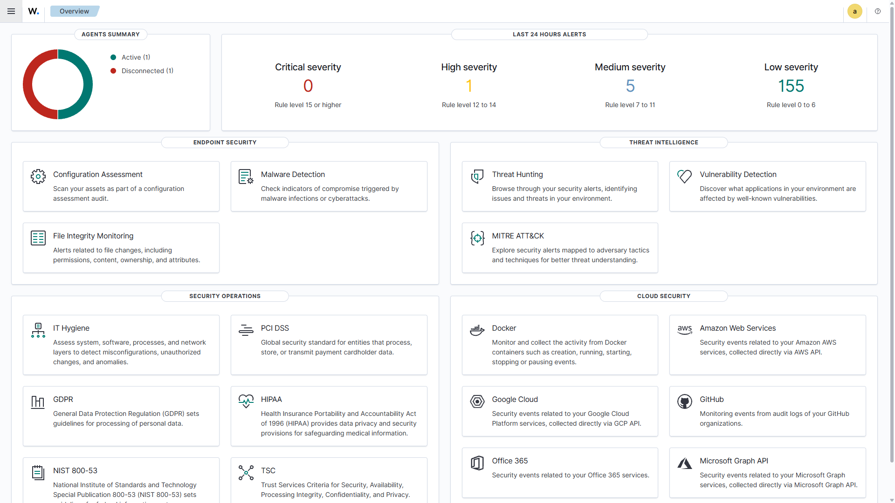
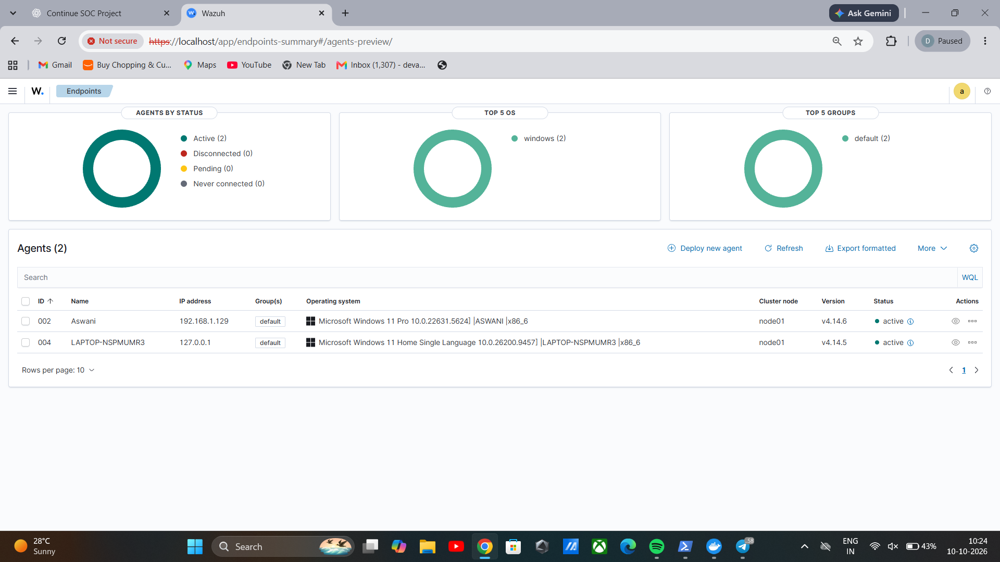
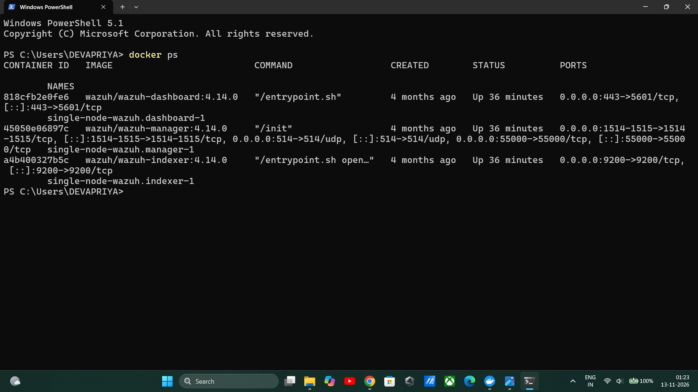
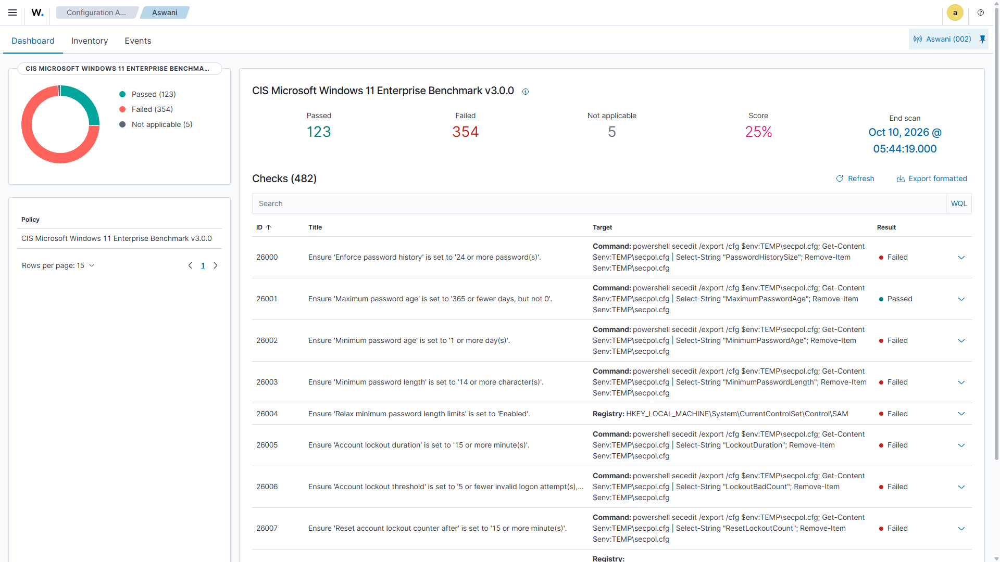
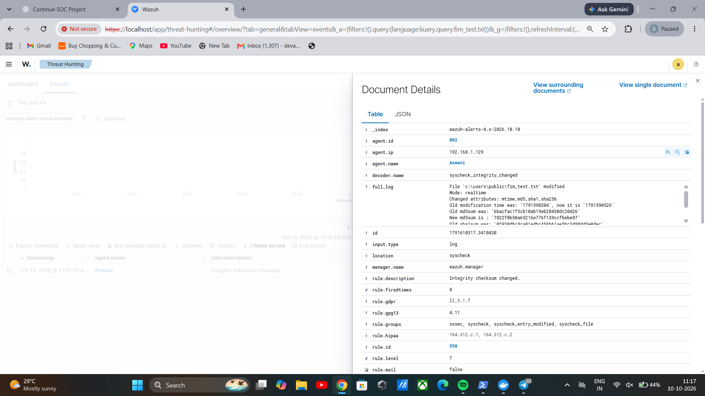
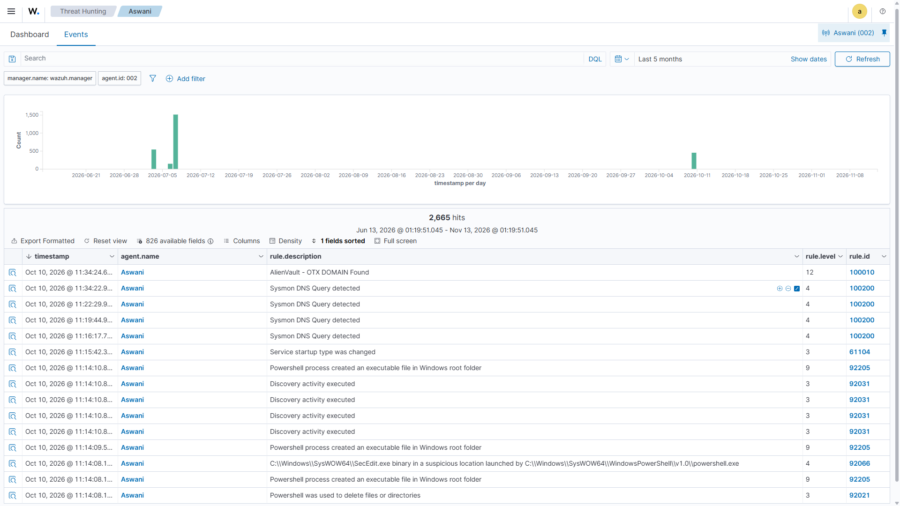
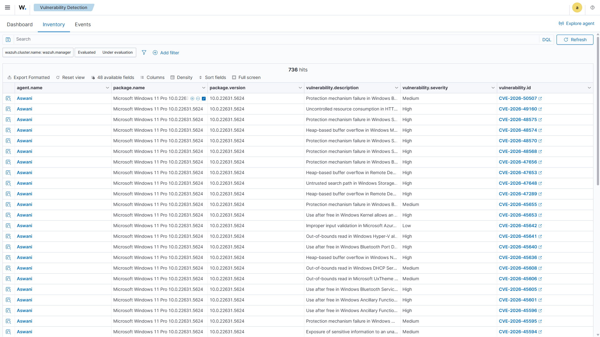
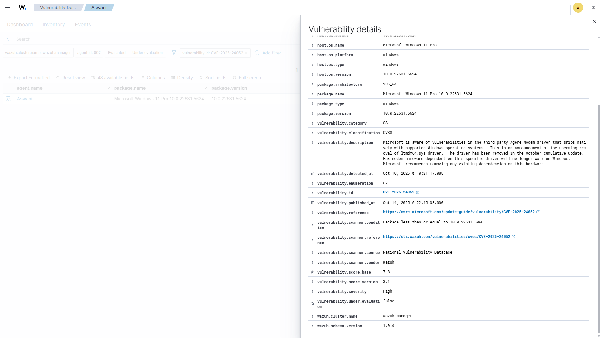

# Wazuh Security Monitoring Lab

## 1. Project Overview

This project demonstrates a hands-on Security Information and Event Management (SIEM) lab using Wazuh.

The objective was to monitor a Windows endpoint, review security configuration issues, and detect file integrity changes through a centralized security monitoring platform.

## 2. Lab Architecture

The lab was configured using two laptops.

| Component | Configuration |
|---|---|
| Security monitoring server | Wazuh Manager, Indexer and Dashboard |
| Deployment | Docker |
| Monitored endpoint | Windows 11 |
| Endpoint monitoring | Wazuh Agent |
| Communication | Agent-to-manager connection |

## 3. Tools and Technologies

- Wazuh Manager, Indexer and Dashboard 4.14.0
- Docker
- Windows 11
- Wazuh Agent 4.14.6
- Security Configuration Assessment (SCA)
- File Integrity Monitoring (FIM)

## 4. Tasks Performed

### 4.1 Wazuh Deployment and Agent Connection

- Deployed Wazuh components using Docker.
- Installed the Wazuh Agent on a Windows endpoint.
- Configured the agent to communicate with the Wazuh Manager.
- Verified the agent's active status in the dashboard.

### 4.2 Security Configuration Assessment

- Explored Windows security configuration checks using Wazuh.
- Reviewed passed and failed security policy checks.
- Identified configuration areas that may require improvement.

Recorded lab result:
- Passed checks: 123
- Failed checks: 350

Failed checks indicate security policy checks that did not pass at the time of assessment. They do not automatically represent confirmed vulnerabilities. Each failed check requires individual review.

### 4.3 File Integrity Monitoring

- Tested real-time File Integrity Monitoring by creating and modifying a file in `C:\Users\Public`.
- Created a test file named `fim_test.txt`.
- Modified the file to generate a security event.
- Verified the resulting alert in the Wazuh Dashboard.

**Verified alert details:**

| Field | Result |
|---|---|
| Alert description | Integrity checksum changed |
| Rule ID | 550 |
| Severity level | 7 |
| Event type | Modified |
| Monitoring mode | Real-time |
| File | `C:\Users\Public\fim_test.txt` |

Wazuh recorded changes to file attributes, including MD5, SHA-1 and SHA-256 checksums.

### 4.4 Vulnerability Detection

- Explored the Wazuh Vulnerability Detection module.
- Reviewed vulnerability records associated with the Windows endpoint.
- Opened CVE details to understand the reported vulnerability information.

## 5. What I Learned

- Basic SIEM architecture and security event monitoring.
- Deploying Wazuh using Docker.
- Connecting a Windows endpoint to a central manager.
- Reviewing Security Configuration Assessment results.
- Testing File Integrity Monitoring and investigating file modification alerts.
- Investigating file modification alerts.
- Basic troubleshooting of agent connectivity and configuration.

## 6. Project Evidence

The following screenshots demonstrate the implementation and testing of the Wazuh Security Monitoring Lab.

### 6.1 Wazuh Dashboard Overview

### 6.2 Wazuh Agent Active Status

### 6.3 Docker Containers

### 6.4 Security Configuration Assessment (SCA)

### 6.5 File Integrity Monitoring (FIM)

### 6.6 Security Events

### 6.7 Vulnerability Inventory

### 6.8 Vulnerability CVE Details

Supporting documentation and configuration files are maintained in:
- `documentation/`
- `configuration/`
## 7. Limitations and Future Improvements

- Expand monitoring to additional Windows security events.
- Practise more alert investigation scenarios.
- Improve threat intelligence integration.
- Document additional incident response exercises.

## 8. Disclaimer

This project was performed in a personal lab environment for educational purposes. Test files and monitoring activities were used to understand security monitoring concepts.

